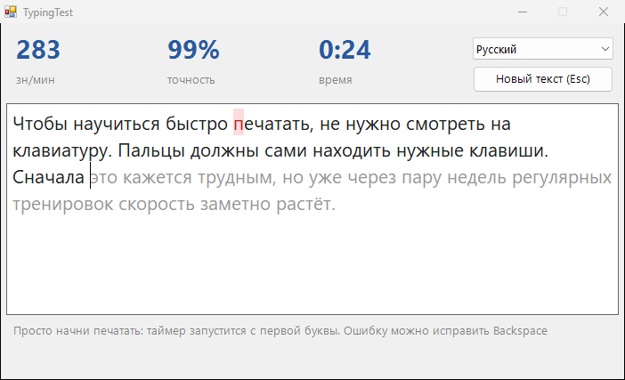

<div align="center">

# ⌨️ TypingTest

**Тест скорости печати на русском и английском: знаки в минуту, точность и личный рекорд**




</div>

## ✨ Возможности

- ⏱️ Таймер стартует с первой буквы, скорость и точность обновляются прямо во время набора
- 🎯 Ошибки подсвечиваются красным, `Backspace` их исправляет
- 🇷🇺🇬🇧 Живые тексты на русском и английском, каждый раз новый
- 🏆 Запоминает личный рекорд для каждого языка (засчитывается при точности от 90%)
- 🤝 Буквы «е» и «ё», разные тире и кавычки считаются одинаковыми, как в большинстве клавиатурных тренажёров
- 🗣️ В конце даёт оценку: от «начало положено» до «уровень профессионала»

## 💡 Когда пригодится

- Узнать свою скорость печати для резюме
- Тренироваться печатать вслепую по 10 минут в день и видеть прогресс
- Посоревноваться с друзьями или детьми

## 📥 Установка

1. Скачай `TypingTest.exe` из раздела [**Releases**](../../releases/latest)
2. Запусти его, установка не нужна

## 🛠️ Сборка из исходников

Нужен только Windows: компилятор C# входит в состав .NET Framework.

```bat
build.bat
```

## 📄 Лицензия

[MIT](LICENSE)
